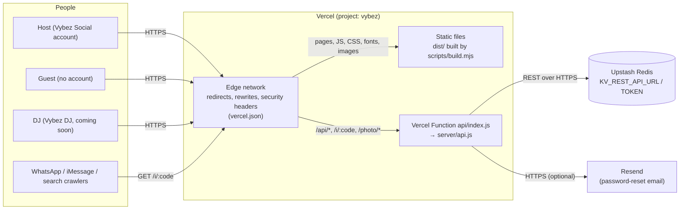
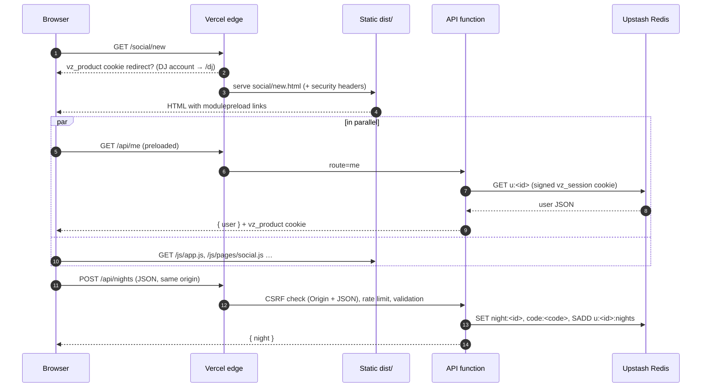

# Vybez architecture

Last reviewed 23 November 2026. Vybez is a static website plus one serverless API function, hosted on Vercel, with Upstash Redis as the only database. There are no runtime npm dependencies and no client framework.

## System context

## Request flow

Invite links are server-rendered so link previews show the night: `/i/:code` is rewritten to the function, which fills the page title and Open Graph tags from Redis (title, date, area, cover photo; never the address) and returns the static invite template built by `scripts/build.mjs`. The browser then loads the invite through `/api/invites/:code`.

## Code map

| Path | What it does |
|---|---|
| `src/pages/**.html` | Pages. Each starts with `<!--meta {...}-->` (title, description, layout, page controller, noindex). |
| `src/layouts/`, `src/partials/` | Shells (`site`, `bare`, `app` = Vybez DJ, `social` = Vybez Social) and shared pieces. |
| `src/js/app.js` | ES module entry: loads the page's module from `src/js/pages/`. |
| `src/js/core/` | Shared browser code: API calls, session, UI helpers, photo cropping, playlist parsing. |
| `src/js/site.js` | Non-module UI behaviour (menus, toasts, toggles). |
| `scripts/build.mjs` | Static build: templates → `dist/`, sitemap, robots, security.txt, manifest, icons, invite template. |
| `api/index.js` | Vercel Function wrapper around `server/api.js`. |
| `server/api.js` | Request entry: invite pages, photos, CSRF, body limits, router, cookies, error handling. |
| `server/lib/http.js` | Errors, validation (`str`, `int`), rate limiting, router. |
| `server/domain/` | Rules and data: users, nights, music, live, email. |
| `server/routes/` | Endpoints by area: auth, account, dj, social. |
| `server/store.js` | Storage: Upstash REST in production, JSON file locally, memory as a last resort. |
| `server/auth.js` | scrypt password hashing, HMAC-signed session cookies. |
| `server/pages.js` | Server-rendered invite previews and cover photos. |

## Data model (Redis keys)

All data lives in one Upstash Redis database as strings (JSON), sets and lists. Preview and Production deployments currently share the same database.

| Key | Type | Holds |
|---|---|---|
| `u:<id>` | JSON | Account: email, name, handle, product, prefs, password hash, session version |
| `email:<email>`, `handle:<handle>` | string | Lookups to the user id (unique, set with NX) |
| `u:<id>:nights` | set | Night ids a host owns |
| `night:<id>` | JSON | Night: title, when, place (address), area, cap, settings, cover |
| `code:<code>` | string | Invite code → night id |
| `night:<id>:g` | set | Guest ids on a night |
| `guest:<id>` | JSON | Guest: name, contact, status, plus-one, songs, pass, check-in |
| `gtok:<token>` | string | Guest's device token → guest id (how a guest proves who they are without an account) |
| `pass:<night>:<pass>` | string | Door pass → guest id |
| `photo:<night>` | string | Host's cover photo (base64 JPEG, ≤600 KB) |
| `u:<id>:activity` | list | Notifications (latest 200) |
| `reset:<token>` | string, 1 h TTL | Password reset links |
| `rl:<key>:<window>` | counter, TTL | Rate limits |
| `set:*`, `crate:*`, `live:*`, `comment:*`, `react:*` | mixed | Vybez DJ (sets, crates, live rooms, comments, reactions) |

The group chat, rides and moments from PR #9 add their own keys (see `server/domain/group.js` once merged).

## Security model in one paragraph

Sessions are HMAC-signed cookies (`HttpOnly`, `SameSite=Lax`, `Secure`) carrying a user id and a session version; changing a password bumps the version and signs out every device. Mutating API calls must be same-origin JSON (blocks cross-site form posts). Passwords use scrypt. Every write is validated and size-limited, sign-up, sign-in, reset, RSVP, night creation and photo upload are rate limited per IP or account. A strict Content-Security-Policy allows only same-origin scripts. Hosts only ever reach their own nights (`hostNight` checks ownership); guests only reach their own RSVP through the device token; the address is only sent to approved guests. See [SECURITY.md](SECURITY.md).

## Environments and deploy

| | Production | Preview | Local |
|---|---|---|---|
| URL | https://vybez-ecru.vercel.app (custom domain to come) | per-branch Vercel URL | http://localhost:3000 |
| Trigger | push to `main` | push to any other branch / PR | `npm run dev` |
| Storage | Upstash Redis | same Upstash database as Production | `.data/db.json` |
| Indexing | indexed (sitemap, robots) | Vercel adds `X-Robots-Tag: noindex` | n/a |

Operating notes, environment variables and rollback are in [OPERATIONS.md](OPERATIONS.md).

## Known limits and next steps

- Preview deployments write to the production database. Give Preview its own Upstash database before real users arrive.
- Photos are stored in Redis as base64. Fine for early access; move to object storage (Vercel Blob) if photo volume grows.
- Updates use polling (15 to 30 s), not realtime.
- No error tracking or uptime monitoring yet (see OPERATIONS.md).
